# Crowsnest media kit

The logo, app icon, typeface and colours, and how to use them.

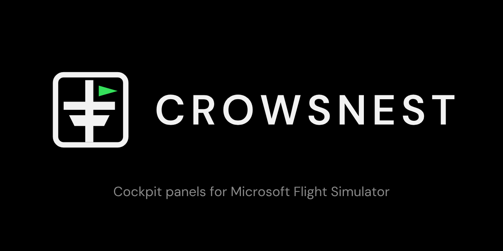

Everything here except `fonts/` is generated by [`tools/build_media.py`](tools/build_media.py).
To change the logo, edit the drawing in that script and rebuild. Don't edit the SVGs or PNGs by hand.

## The mark

A crow's nest on its mast, flying a green pennant, inside the rounded frame the panels draw
around their values. White on black, like the panels.

| | On dark | On light |
|---|---|---|
| **Mark**: app icon, avatars, favicons | 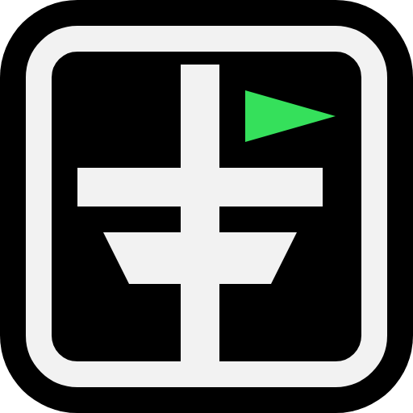 | 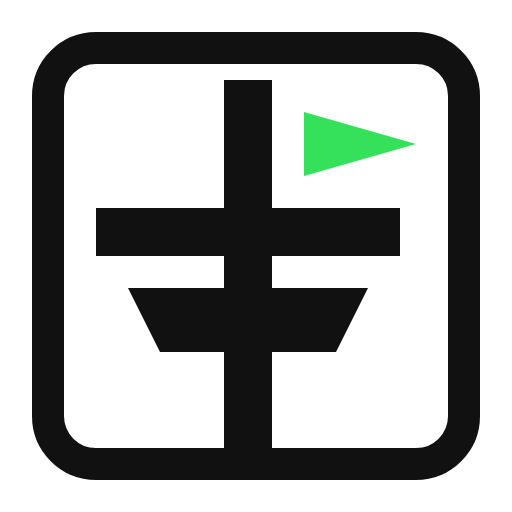 |
| **Horizontal**: page headers, the README, slides |  | 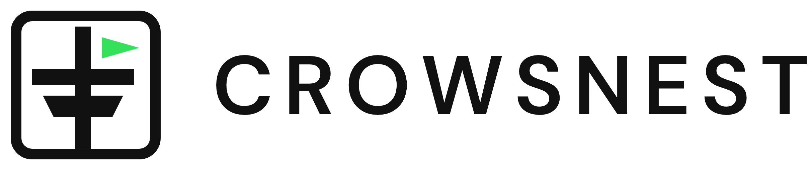 |
| **Stacked**: square spaces, splash screens | 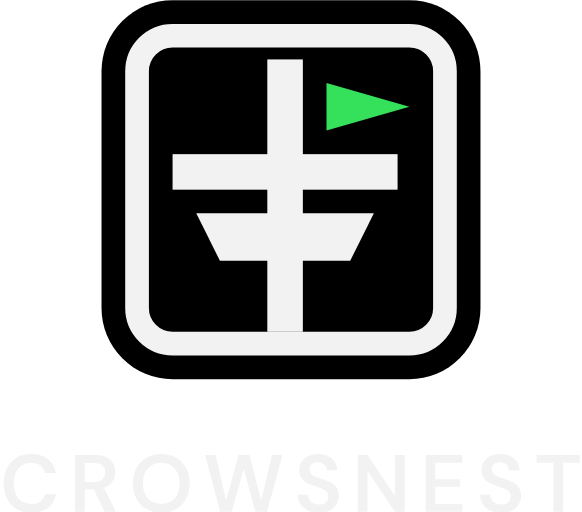 |  |
| **One colour**: engraving, stickers, print in one ink |  | 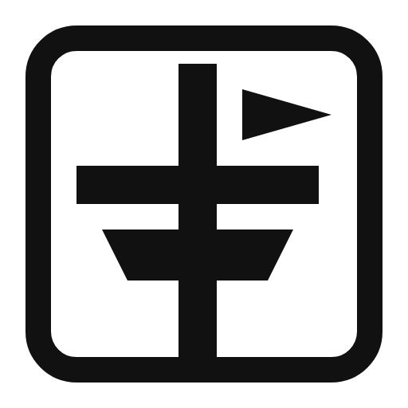 |
| **Wordmark only**: where the mark is already present |  | 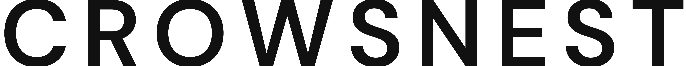 |

Use the SVGs in `logo/svg/` wherever you can. The PNGs in `logo/png/` are 512 px tall.

**Clear space.** Keep a margin of at least a quarter of the mark's width clear on every side.

**Minimum size.** 16 px. The same drawing is used at every size.

### Construction

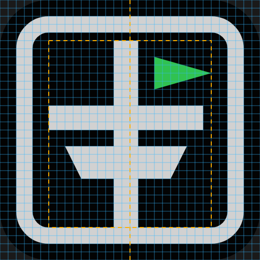

The mark is drawn on a 32 × 32 grid. One cell is a pixel at 32 px and half a pixel at 16 px.
The dashed box is the content area, and the dashed line is the centre.

| Rule | Value | Why |
|---|---|---|
| Two weights | Frame 2 cells; mast and rim 3 | The structure is heavier than its container, so the nest reads first |
| One gap | 2 cells everywhere: flag to mast, flag to rim, rim to basket, frame to contents | Even spacing looks deliberate. 2 cells is 1 px at 16 px, the smallest gap that survives |
| Corners | Only the frame is rounded, concentrically: tile radius 6, frame 4 outside and 2 inside. Everything inside is square | It echoes the panels' frame. A radius under a pixel is invisible at icon sizes anyway |
| Optical centre | The mast sits half a cell left of centre | The flag adds weight on the right. Mast plus flag together are centred |
| The flag | Hangs 2 cells below the mast top; 7 long and 4 tall, so its tip is centred | The mast shows above the flag, like a real pole |
| The basket | Sides taper 1 cell in 2 | A steady slope that steps evenly on the pixel grid |

Change a coordinate only by whole cells, and keep to these rules.

**Don't** recolour the pennant anything but panel green (or the one ink of a one-colour
print), put the on-dark mark on a light background, stretch it, add effects, or set the
wordmark in another typeface.

## App icon

`icon/crowsnest.ico` holds 16, 20, 24, 32, 40, 48, 64, 96, 128 and 256 px, all from the one
drawing. The same sizes are in `icon/png/`.

## Typeface: DM Sans

[DM Sans](https://fonts.google.com/specimen/DM+Sans), under the SIL Open Font License
([`fonts/OFL.txt`](fonts/OFL.txt)), so it can ship inside the app and the installer. The files
in `fonts/` are the variable fonts (weight 100 to 1000, optical size 9 to 40), roman and italic.

| Use | Setting |
|---|---|
| Wordmark | `CROWSNEST`, all caps, SemiBold (600), letter-spacing 0.12 em, optical size 24. Always outlined, never live text |
| Headings | SemiBold (600) or Bold (700), sentence case |
| Body and UI | Regular (400); Medium (500) for emphasis |
| Captions and labels | Medium (500), all caps, letter-spacing 0.06 em, like the panels' page labels |

## Colour

The panels' own palette, from the firmware's `components/crowsnest_ui/ui_view.h`. Use the
same values everywhere, so a screenshot of the app and a photo of the panel look like one
product.

| | Name | Hex | Use |
|---|---|---|---|
|  | Black | `#000000` | Background. The panel's screen |
|  | Panel white | `#F2F2F2` | The mark, the wordmark, text on black |
| 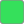 | Active green | `#35E05B` | The pennant; "connected", "in use" |
|  | Amber | `#FFB000` | Waiting, not yet confirmed |
|  | Cursor blue | `#35B7FF` | Selection, links, focus |
| 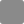 | Label grey | `#8A8A8A` | Secondary text and labels on black |
|  | Ink | `#111111` | The mark and text on light backgrounds |

Green and amber are signals, not decoration. Keep them for state, as the panels do.
Green on white is too faint for text (under 2:1), so use it for shapes only on light
backgrounds.

## Social image

`social/crowsnest-social.png` is 1280 × 640, the size GitHub uses for a repository's social
preview. Its tagline, "Cockpit panels for Microsoft Flight Simulator", is a placeholder until
there's a settled one.

## Panel waiting screen

`panel/crowsnest-waiting.png` is the stacked logo as the panels draw it while they wait for
the app: 198 × 173 on black, with the mark at 128 px (4 px a grid cell, so it stays sharp).
The build also writes it into the firmware as an LVGL image,
`firmware/crowsnest-display/components/crowsnest_ui/images/ui_logo.c`. Reflash a panel
to see a change.

## Rebuilding

From the repository root:

```powershell
python -m venv .venv-media
.venv-media\Scripts\python -m pip install -r media\tools\requirements.txt
.venv-media\Scripts\python media\tools\build_media.py
```

It needs Chrome or Edge installed to render the PNGs, and it takes about ten seconds.
